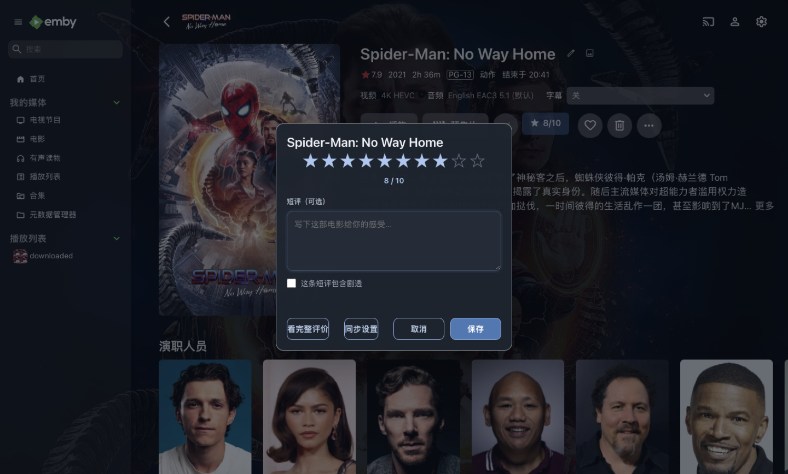
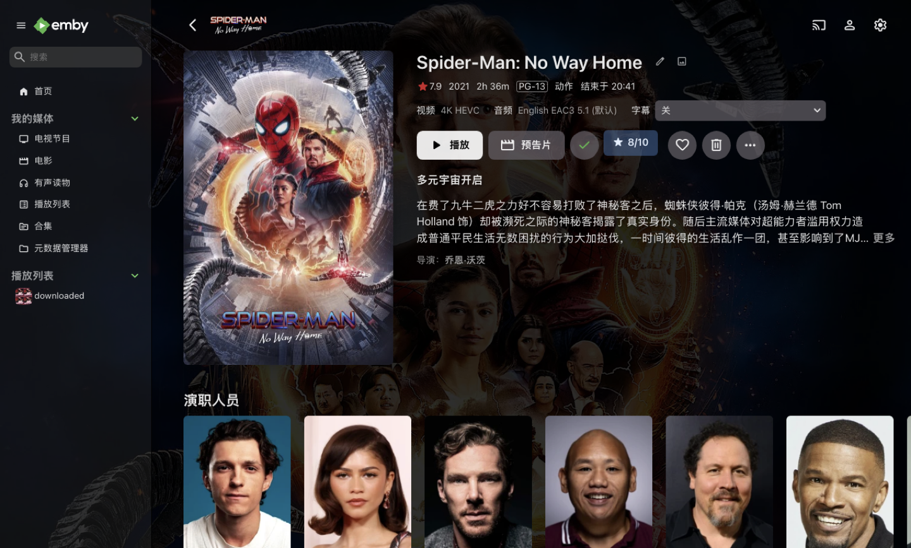
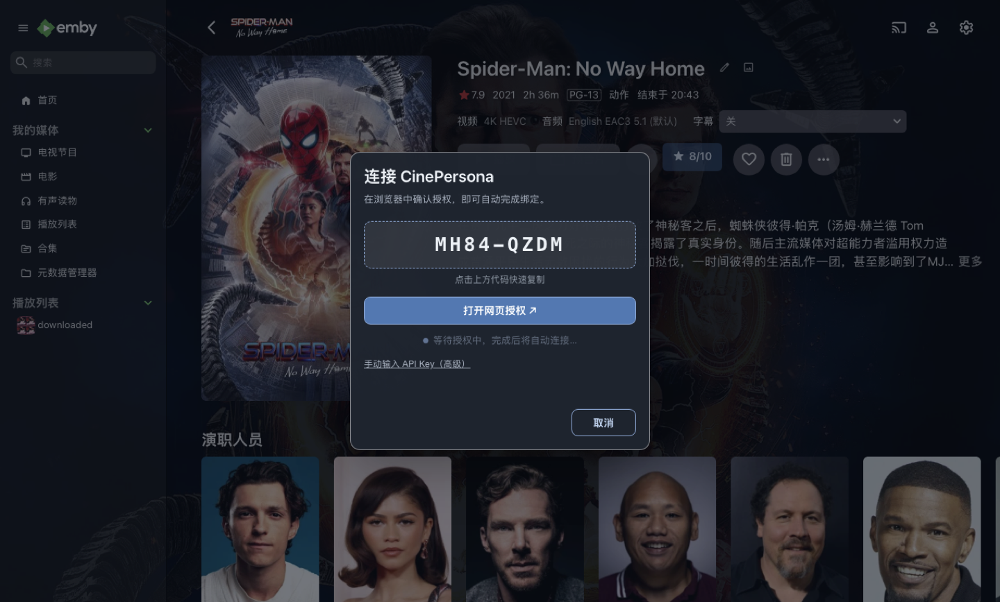

# CinePersona Media Server Plugins

[English](README.md) | [简体中文](README.zh-CN.md)

Official media server sync plugins for [CinePersona](https://cinepersona.com) — automatically sync watched movies, TV episode playback progress, personal ratings, and short reviews between your media server and your CinePersona watch history.

## Screenshots



| In-Page Action Bar & Synced Score | One-Click RFC 8628 Device-Code Pairing |
| :---: | :---: |
|  |  |

## Included Components

- **`jellyfin/Jellyfin.Plugin.CinePersona`** — Native C# plugin for **Jellyfin 10.10+** (`.NET 8`).
- **`Emby.Plugin.CinePersona`** — Native C# plugin for **Emby Server 4.8.x** (available in both a standard catalog build and a Geek build with Web UI rating injection).
- **`plex/CinePersona.PlexRelay`** — Lightweight Go companion webhook relay for **Plex**.

## Features

- **Automatic Playback Scrobbling**: Marks movies and TV episodes as watched in CinePersona once playback reaches 80% completion (carries TMDB, IMDb, and TVDB provider IDs, title, year, and season/episode metadata).
- **Bidirectional Sync**: Optionally syncs watched status and ratings back from CinePersona to your media server every 6 hours.
- **RFC 8628 Device-Code Pairing**: Link each media server user to their own CinePersona account with a one-click browser verification code (or configure an API key manually at `https://cinepersona.com/settings/api-keys`).
- **In-Page Rating & Short Review Dialog** *(Jellyfin & Emby Geek build)*: Adds a rating trigger right in the movie detail action bar to rate (1–10), write short reviews, mark spoilers, and jump straight to the CinePersona film page.

## Installation

### Jellyfin

1. Open **Jellyfin Dashboard → Plugins → Repositories** and add the CinePersona repository URL:
   ```text
   https://cinepersona.com/jellyfin.json
   ```
   *(Or download the release zip manually from [GitHub Releases](https://github.com/cinepersona/cinepersona-media-server-plugins/releases).)*
2. Install **CinePersona** from the Catalog and restart Jellyfin.
3. Open the CinePersona plugin settings (or click the **Connect** button on any movie detail page) to pair your account via device code or paste a CinePersona API key (`sync.write` + `library.read`).

> **Note for Docker users**: The optional in-page Web rating button injects a `<script>` tag into Jellyfin's `jellyfin-web/index.html`. If your container mounts `jellyfin-web` read-only, server-side playback and rating sync still work normally without the Web overlay.

### Emby

Two Emby release builds are provided (do not install both at the same time):

- **`Emby.Plugin.CinePersona.dll` (Standard / Catalog build)**: Pure server-side playback, rating, and reverse sync using native Emby APIs without modifying Emby Web files.
- **`Emby.Plugin.CinePersona.Geek.dll` (Geek build)**: Adds the embedded Emby Web movie detail rating & short-review dialog by injecting into `dashboard-ui/index.html`.

1. Download the DLL from [GitHub Releases](https://github.com/cinepersona/cinepersona-media-server-plugins/releases) (or use `https://cinepersona.com/emby.json`).
2. Place the DLL into Emby Server's `plugins` folder and restart Emby.
3. Configure your CinePersona API key (`https://cinepersona.com/settings/api-keys`) in the plugin settings.

### Plex Relay

See [`plex/CinePersona.PlexRelay`](plex/CinePersona.PlexRelay) for running the lightweight Go webhook forwarder (`POST /v1/webhook/plex`).

## API Endpoints

Plugins communicate with CinePersona (`https://cinepersona.com` by default) via:

- `POST /v1/webhook/emby`, `POST /v1/webhook/jellyfin`, `POST /v1/webhook/plex`
- `POST /open/v1/device/code`, `POST /open/v1/device/poll`
- `GET /open/v1/movies/lookup/rating`

## License

MIT — see [LICENSE](LICENSE).
