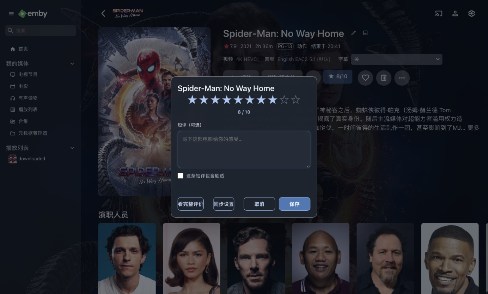
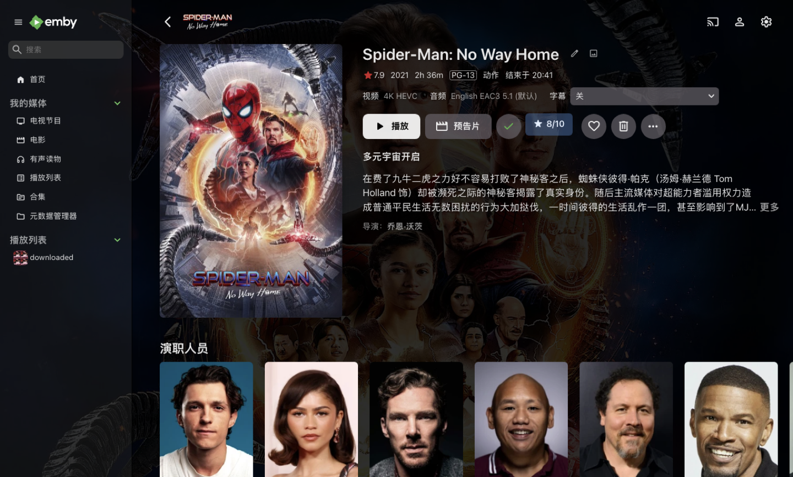

# CinePersona 媒体服务器插件集合

[English](README.md) | [简体中文](README.zh-CN.md)

[CinePersona](https://cinepersona.com) 官方媒体服务器同步插件集合：电影与剧集播放完成度达到 80% 后，自动将观影记录与播放进度同步到 CinePersona；支持双向同步、设备码一键授权绑定以及网页端内嵌评分与短评弹窗。

## 实机截图

| 电影详情页操作栏同步评分入口 | RFC 8628 设备码一键授权绑定 |
| :---: | :---: |
|  |  |

## 包含组件

- `jellyfin/Jellyfin.Plugin.CinePersona`：Jellyfin 10.10+ 原生 C# 插件。
- `Emby.Plugin.CinePersona`：Emby Server 4.8.x 原生 C# 插件（分标准审核版与 Geek 网页增强版）。
- `plex/CinePersona.PlexRelay`：Plex Webhook 轻量转发服务（Go）。

## Emby 发布通道

- **标准审核版（`Emby.Plugin.CinePersona.dll`）**：仅使用 Emby 原生插件配置页和服务端事件，不修改 Emby 网页文件、不注入 JavaScript；提供观看状态、个人评分同步与反向同步。
- **Geek 增强版（`Emby.Plugin.CinePersona.Geek.dll`）**：在标准版基础上额外注入 Emby Web 电影详情页的评分、短评与剧透标记弹窗（会修改 `dashboard-ui/index.html`）。请勿与标准版同时安装。

## 安装方式

### Jellyfin
1. 进入 **Jellyfin 控制台 → 插件 → 存储库**，添加仓库地址：`https://cinepersona.com/jellyfin.json`（或从 [GitHub Releases](https://github.com/cinepersona/cinepersona-media-server-plugins/releases) 手动下载）。
2. 在目录中安装 **CinePersona** 并重启 Jellyfin。
3. 在插件设置或任意电影详情页点击「连接」完成设备码授权，或在 `https://cinepersona.com/settings/api-keys` 创建 API Key（勾选 `sync.write` 与 `library.read`）填入。

> **Docker 用户提示**：网页内嵌评分按钮会向 `jellyfin-web/index.html` 注入脚本；如果容器内 `jellyfin-web` 目录为只读，服务端观影与评分同步仍可正常工作，仅不显示网页内嵌按钮。

### Emby
1. 从 [GitHub Releases](https://github.com/cinepersona/cinepersona-media-server-plugins/releases) 下载 `Emby.Plugin.CinePersona.dll`（标准版）或 `Emby.Plugin.CinePersona.Geek.dll`（含网页评分弹窗版）。
2. 将 DLL 放入 Emby Server 的 `plugins` 目录并重启。
3. 在后台插件设置中配置 API Key（默认服务器地址 `https://cinepersona.com`）。
